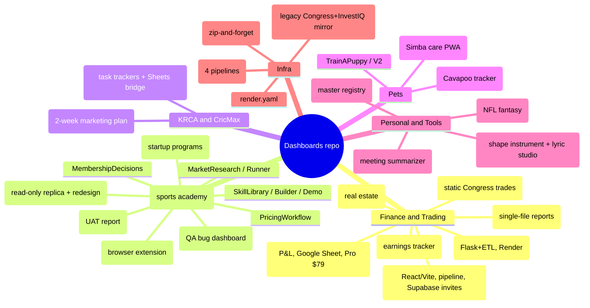

# Dashboards repo — App Catalog & Mindmap
_Generated 2026-11-12 from a repo review. Public repo: no secrets here. Live base URL: `https://apatel85.github.io/Dashboards/<Dir>/`._
_Pickup protocol: read `AGENTS.md`, then the app's `AGENTLOG.md` (newest on top). `Verified: no` = not proven. Master registry of everything (incl. Muse artifacts/PDFs): `AppRepoTracker/`._

## Mindmap

## Catalog
| Dir | Nature | What it includes | Tech / hosting | Log |
|---|---|---|---|---|
| **TradeDesk** | Stock research hub (largest app, ~40MB incl. data) | Tabs: Daily Brief, Options, Signals, Earnings, Congress & Gov, Research, Screener, Deep Dive, Performance, Admin. ES/NQ gamma (GEX), Congress/WH flow signals, ~15-min Yahoo quotes, Schwab live, lotto picks, prediction-performance tracking. Invite-only (Supabase `tradedesk_invites`, AuthGate fails closed) | React+TS+Vite → `dist/`; Node pipeline (`pipeline/*.mjs`) writing `public/data/*.json`; Actions cron (weekday 05:00 UTC pipeline; research agent Sun/Wed) | yes (v2026-11-10m) |
| **EarningAnalysis** | Weekly earnings tracker | Companies reporting this/next week, filter by sector/cap/timing; mock-data mode + live-data go-live guide (`HOW_TO_USE.md`); root index redirects to build | Node + Python scripts, `dist/`; Action `update-earnings.yml` (Fri 22:00 UTC) | no |
| **CongressTradeTracker** | Congress/White House trade tracker, 4-source verified | CongressInvests + House eFD + Senate eFD + OGE 278 → staging DB → verification/confidence engine → master trades → web app with login | Flask/gunicorn + SQLite, Render (`render.yaml`); `etl_refresh.yml` every 6h | no |
| **CapitolPulse** | Static Congress trading tracker | Client-side fetch of CongressInvests, 24h localStorage cache, force-refresh | Static, no build | no |
| **PLDashboard** | P&L Dashboard v9 (monetization copy; never touch `apatel85/pl-dashboard`) | Customer's own Google Sheet as data store, magic-link auth + license keys, Free = 1 business / Pro $79 (Lemon Squeezy), admin page, 129 tests | Single-file PWA, Supabase, Playwright | yes — **partial verify**, awaiting Ankit setup steps |
| **PL_CSO**, **Sales&COGS** | Single-file HTML reports (`PL_CSO_Dashboard.html`, `Sales_COGS_Dashboard.html`) | Finance dashboards; undocumented | Static | no |
| **InvestIQ / InvestIQV2** | Real-estate intelligence. V1 was truncated/non-functional; V2 is the working rebuild | Live property listings, STR-vs-LTR view, real data (`data/markets.json`) | Static HTML/JS | no |
| **QuixeraDev** | QA bug dashboard (view-only, no credential) | QA-team/Manual/Arlo segments, plain-English click trails, issue badges, video, status filter; extension v3.9.0 packaged | Static, `build_dashboard.py` builds from `bugs/` + `data/` | yes — partial |
| **QA-Capture** | Chrome/Edge/Brave/Android QA extension | Click trail + screenshot, files bug to chosen dashboard via GitHub token, generic builder | MV3 extension (`build_generic.py`) | no (README/PRIVACY) |
| **QuixeraDemo** | Replica of live Quixera Admin Dashboard + redesign toggle. **Live app is read-only, never touch** | Enhancements only here | Static | yes |
| **QuixeraUAT** | UAT QA report 2026-10-10 | Facility UAT findings | Static single file | no |
| **QuixeraPrograms** | 16 startup programs action dashboard | Cards, numbered steps, owners, deadlines, status, flagged missing deadlines | Static | yes |
| **SkillLibrary** | Click-through mockup of Skill Library redesign | 9 screens (landing, library page, sub-skill editor, create, edit mode, pathways, mobile, suggestions) | Static | yes |
| **SkillLibraryBuilder** | Working blank-start builder | 3-step create, stage map, drill bank, programs, coach mobile, local JSON export/import | Static, localStorage | yes |
| **SkillLibraryDemo** | Simplest rebuild (5-step journey) | One screen = one job, example library, Export/Import/Reset | Static, localStorage | yes (newest) |
| **MembershipDecisions** | Decision aid | 32 use cases, filters, 16 open decisions, decision tree | Static | yes |
| **PricingWorkflow** | Simplified pricing workflow demo | One workflow for all 32 use cases, simulator, F0–F17 log, 13 red flags | Static | yes |
| **MarketResearch** | Password-gated research viewer | One tab per project, verdict/SWOT/red flags, PDF export, scoped share links | Static | yes |
| **MarketResearchRunner** | Runs research | Framing wizard, 8-phase workspace, commission brief, request queue, results library | Static | yes |
| **CricMaxConnect** | Task trackers | CricMax task monitor (Supabase auth, offline, Sheets v2.1) + Ankit x Arpit tracker (workstream tabs); Apps Script bridge, URL hardcoded | Static + `tracker-apps-script.gs` | yes |
| **krca** | KRCA 2-week marketing plan "Winter Lab" | Marketing plan page (~8MB) | Static | no |
| **WagWise** | Simba care PWA (v3.27.14) | Quick-log + voice parsing, bladder model/risk gauge, schedule alerts, trends, clinical audit, meds/vaccines, GPS walks, multi-pet | PWA + Supabase | yes — **NOT verified**: logs vanish on refresh (suspected RLS) |
| **PawPulse** | Cavapoo care tracker | Vaccines, vets, insurance | PWA | no |
| **TrainAPuppy / V2** | Puppy training dashboards | 8-week curriculum, today's session, progress; V2 adds progress.json | PWA | no |
| **KineticMusic** | KINETIC // Studio v3.2 | Shape instrument, lyrics-to-song, 6 synth voices, karaoke mic, kids mode, MIDI export | Static, Web Audio | yes — verified |
| **VoiceInsight** | Meeting summarizer PWA v1.0.4 | Record/upload/paste → summary → toned email; Gemini→Groq→OpenRouter; Wispr-style polish + auto-corrections | PWA | yes — **not verified** |
| **WeeklyStatDashboard** | NFL Week 10 fantasy projections | Projections + Results auto-grading | Static | no |
| **AppRepoTracker** | Master registry (v1.0.10, 43 entries / 26 live) | Every app/doc/mock with links, dates, thread, flags. Standing rule: every new app gets an entry | Static | yes |
| **docs/** | Legacy GitHub Pages copy of Congress tracker + InvestIQ | `master_trades.json`, `meta.json` | Static | no |

## Root-level files
`index.html` (landing cards) · `DASHBOARD_BLUEPRINT.md`, `plan.md`, `planv2.md` (design/planning docs) · `CLAUD.md` (generic AI workflow prefs) · `auto-deploy-zip.yml` (zip-and-forget deploy) · `render.yaml` · `CricMaxConnect_Tracker` (stray 1-byte file).

## Observations
- Not yet in AGENTS.md app table: most apps (only 7 listed). AppRepoTracker is the fuller list.
- Unverified fixes to re-check before building on them: WagWise v3.27.14, VoiceInsight v1.0.4, PLDashboard v9 setup, QuixeraDev popup capture.
- `AppRepoTracker` lists Muse-only items (SimbaTelemetry, KRCA mocks, PDFs, ICS) that have no folder here.
